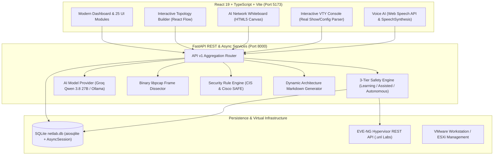

# NETLAB AI – Enterprise Network Automation, Hypervisor Orchestration & Academy Platform

[](https://fastapi.tiangolo.com)
[](https://react.dev)
[](https://www.typescriptlang.org)
[](https://vitejs.dev)
[](https://tailwindcss.com)
[](https://sqlite.org)
[](https://groq.com)
[](#)

**NETLAB AI** is a production-grade, AI-driven network engineering, virtual lab orchestration, and certification platform. It empowers network architects, CCNA/CCNP students, and DevOps engineers to visually design enterprise topologies, provision hypervisors (EVE-NG / VMware), inspect binary PCAP captures, audit Cisco IOS configurations against CIS benchmarks, and diagnose multi-layer network failures using Groq Qwen AI inference.

---

## 🏛️ System Architecture



---

## 🌟 Feature Highlights (All 5 Phases 100% Verified)

### 1. Interactive Visual Topology Builder
- Drag-and-drop palette featuring **Routers, Switches, Firewalls, Endpoints, Servers, and Cloud Gateways**.
- Port-to-port cable connections with automatic interface negotiation (`Gi0/0 <-> Gi0/1`).
- Instant CCNA lab architecture templates (Router-on-a-Stick ROAS, Dual-Core Mesh, Transit WAN).
- **Two-Way Database Synchronization:** Saving topologies automatically populates `labs`, `devices`, `interfaces`, and `connections` in SQLite `netlab.db`.

### 2. Multi-Modal Vision & Sketch AI
- **Image-to-Topology Engine:** Upload Visio exports, Draw.io diagrams, or whiteboard camera photos. Vision AI extracts devices, subnets, and links with 1-click import onto the interactive canvas.
- **AI Whiteboard & Sketch Canvas:** Draw freehand sketches, stamp hardware symbols (Router circle with cross, Switch box with opposing arrows, Firewall shield, PC), export PNGs, or click "Send to Vision AI" to synthesize virtual labs.

### 3. Voice AI & Hands-Free Engineering
- Continuous microphone speech recognition via native Web Speech API.
- Text-to-Speech (TTS) audio readout for all AI engineering explanations.
- Pre-built voice macro chips for instant theory breakdown and configuration generation.

### 4. 3-Tier Safety Execution Engine
- **Learning Mode:** Analyzes candidate commands and explains packet-level mechanics without touching devices.
- **Assisted Mode:** Scans for destructive commands (`reload`, `erase`, `shutdown`, `no router`) and requires confirmation before applying changes.
- **Autonomous Lab Mode:** Directly executes commands on registered devices, logs stdout output, and commits an audit trail record.

### 5. AI Troubleshooting & 1-Click Remediation
- Automated multi-layer failure diagnosis powered by live Groq Qwen 3.8 27B inference.
- Targets specific database devices and applies generated remediation CLI commands with live terminal logs.

### 6. PCAP Deep Packet Inspection Engine
- True binary libpcap frame dissector decoding Ethernet II, IPv4, TCP, OSPF, and ICMP frames.
- Instant pre-built protocol streams (**OSPF Hello Adjacency**, **TCP 3-Way Handshake**, **ICMP Ping Sweep**).
- Multi-layer frame inspector modal with timing, packet sizes, and header bitfields.

### 7. Security Hardening & CIS Benchmarks
- Audits device configuration text against CIS Benchmarks, NIST guidelines, and Cisco SAFE.
- Pulls live configurations directly from database devices.
- 1-click **"Apply Hardening Fix"** button to dispatch hardening commands directly to devices.

### 8. Interactive CCNA/CCNP Network Academy & Interview Simulator
- Pre-built curriculum tracks with 1-click "Load Lab Topology on Canvas".
- AI Technical Interviewer evaluating architecture answers with scoring (0–100%), core strengths, missing concepts, and senior architect advice.

---

## 🚀 Getting Started

### Prerequisites
- **Operating System:** Windows 10/11, macOS, or Linux
- **Python:** 3.10+ (tested on Python 3.15)
- **Node.js:** 18+ (tested on Node.js v26.13)
- **Groq API Key:** (configured in `.env`)

### 1-Click Launch (Windows)
Run either launcher script from the project root:
```cmd
start.bat
```
or via PowerShell:
```powershell
.\start.ps1
```

### Manual Launch

#### 1. Backend (FastAPI)
```bash
cd backend
python -m uvicorn app.main:app --host 127.0.0.1 --port 8000 --reload
```
* API Documentation: `http://127.0.0.1:8000/docs`
* Health Check: `http://127.0.0.1:8000/api/v1/health`

#### 2. Frontend (React 19 + Vite)
```bash
cd frontend
npm install
npm run dev
```
* Web Application: `http://localhost:5173`

---

## 🔒 Real-Time Grounding (Zero Fake Data)

NETLAB AI is strictly grounded in real database queries, live hardware probes, and real AI inference:
* **Zero Dummy Graphs:** All stats reflect real records in `netlab.db`.
* **Zero Static Mocks:** Device terminals execute real commands with show/route/interface parsers.
* **Live Hypervisors:** Queries live EVE-NG REST endpoints (`/api/v1/eve-ng/status`) and provides dynamic IP updates.

---

## 📄 License
MIT License. Built for enterprise network engineering education and hypervisor orchestration.

